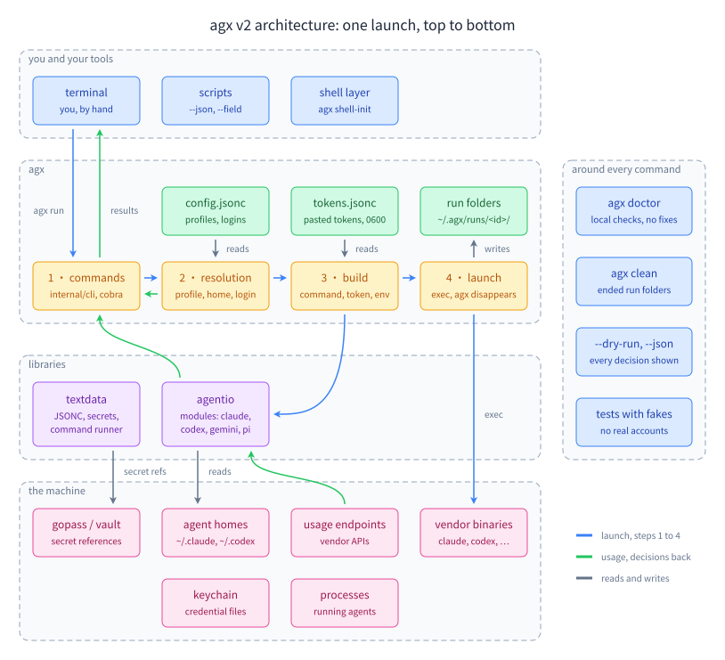

# agx

**One CLI for every coding agent and every account on your machine.** agx starts Claude Code, OpenAI Codex, Gemini CLI, pi and any agent you describe in config, on the right home and the right login, and shows you where every decision came from.

    [](https://pkg.go.dev/github.com/ubgo/agx)

agx is an open-source command-line account and launch manager for AI coding agents, written in Go. It runs Claude Code, OpenAI Codex, Gemini CLI and pi on any of your accounts: several Claude Pro or Max plans, a Codex login, a Gemini API key, a client's account that must be used in the client's repository. It switches the agent's home folder and login per launch, binds accounts to project folders, shows plan usage across every home, finds and resumes conversations wherever they are stored, and passes models, settings, autonomy levels and environment variables the same way for every agent. Tokens come from gopass, a command or an environment variable and are never printed unless you ask with `agx login token`.

## Contents

- [Why agx](#why-agx)
- [Install](#install)
- [Quick start](#quick-start)
- [Supported agents](#supported-agents)
- [Commands](#commands)
- [Architecture](#architecture)
- [Documentation](#documentation)
- [Platforms](#platforms)
- [FAQ](#faq)
- [Moved from khanakia/agx](#moved-from-khanakiaagx)
- [Contributing, security and license](#contributing-security-and-license)

## Why agx

You have two Claude plans, a Codex login, a Gemini key, and a client repository that must always run on the client's account. Every agent stores its login, settings and history in its own home folder, and each one picks a home from a different environment variable. Switching by hand means exporting the right variable, unsetting the ones that would outrank it, and remembering which account you are on.

agx makes that one command:

- **Profiles** name each home: `agx run --profile work`.
- **Logins** run any home on any account: `agx run --profile work --login carol`, with the token taken from gopass, a command or a variable and never printed (only `agx login token` prints one, on request).
- **Folder bindings** pick the account per repository, per agent: a plain `agx run` in the client repository uses the client profile.
- **Usage** across every home and login at once: `agx usage`.
- **Teach your agent agx**: `agx skill --install` writes a Claude Code skill listing every agx command and flag, generated from the binary.
- **Login pools** move one Claude session between your and your teammates' accounts by itself as quotas fill: `agx run --login auto` on a `pool` login, `agx login pick --id auto` to see the pick and why, `! agx whoami` inside Claude to see the account in use.
- **Resume** finds the home that stores a conversation: `agx resume --id 3f2a9c1e`.
- **Every option** reaches the agent the same way for every vendor: settings, typed options, environment, autonomy levels and raw flags.

What agx never does: guess, discover accounts behind your back, edit an agent's own settings files, refresh an OAuth token, print one unless you ask with `agx login token`, or run an agent with more autonomy than you asked for.

### How it compares

| | agx | Exporting variables by hand | A switcher for one vendor |
|---|---|---|---|
| Claude Code, Codex, Gemini CLI, pi and your own agents | yes, one set of commands | yes, a different variable and rule per agent | one vendor each |
| Account chosen per project folder | yes, per agent (`agx project use`) | no, unless you add a per-folder tool | varies |
| Shows which source decided each value | yes (`--dry-run`) | no | varies |
| Token kept out of your shell and output | yes: resolved at launch, set only in the agent's environment, `[redacted]` everywhere | no: the token sits in your shell's environment | varies |
| Plan usage of every home at once | yes, for agents with plan usage (Claude Code, Codex) | no | varies |
| Resume a conversation on the home that stores it | yes (`agx resume --id`) | no: you search each home | varies |
| Agent settings files left untouched | yes: options apply to one launch | yes | varies: some switch accounts by rewriting the agent's credential or settings file |

If you only ever use one account of one agent, you do not need agx. Once you have two homes, two accounts or two agents, agx is the one place that decides, and it tells you how it decided.

## Install

```sh
go install github.com/ubgo/agx@latest
agx version
```

This needs Go 1.26.4 or newer and puts `agx` in `$(go env GOPATH)/bin`, which needs to be on your `PATH`.

Prebuilt binaries (macOS and Linux on amd64 and arm64, Windows on amd64) are on the [Releases page](https://github.com/ubgo/agx/releases), with a `checksums.txt`:

```sh
# macOS on Apple Silicon: swap darwin_arm64 for darwin_amd64, linux_amd64 or linux_arm64
curl -fsSLO https://github.com/ubgo/agx/releases/download/v0.4.8/agx_v0.4.8_darwin_arm64.tar.gz
curl -fsSLO https://github.com/ubgo/agx/releases/download/v0.4.8/checksums.txt
shasum -a 256 -c checksums.txt --ignore-missing
tar -xzf agx_v0.4.8_darwin_arm64.tar.gz agx && sudo mv agx /usr/local/bin/
agx version
```

## Quick start

A machine with Claude Code (homes `~/.claude` and `~/.claude-work`), Codex, Gemini CLI and pi installed, and no agx config yet. Every block below is real output from the example [readme-tour](examples/readme-tour/README.md), which the test suite runs on a fake machine, so it shows what agx prints today.

Write a config from the homes already on the machine:

<!-- snippet: examples/readme-tour/session.txt#setup -->
```text
$ agx config init --default-agent claude --discovered
wrote ~/.agx/config.jsonc (2 profiles)

$ agx profile list
PROFILE    PROVIDER  HOME            ACCOUNT  STATE  LOGIN       BILLING
*personal  claude    ~/.claude                none   home login  plan
work       claude    ~/.claude-work           none   home login  plan
```

Add a login whose token stays in gopass, then ask what a launch on it would do. `--dry-run` prints every decision with its source and starts nothing; the token is not even resolved, and the variable it fills reads `[redacted]`:

<!-- snippet: examples/readme-tour/session.txt#login -->
```text
$ agx login add --name carol --agent claude --kind oauth-token --token-ref '${gopass:personal/claude/carol}'
added login carol (oauth-token, reference gopass)

$ agx run --profile work --login carol --model opus --dry-run
agx: warning: installed Claude Code version unknown; flags not checked
agent    claude                                  from profile work
profile  work                                    from --profile
home     ~/.claude-work                          from profile work
login    carol (not resolved: --dry-run)         from --login
binary   /usr/local/bin/claude version unknown   from no install metadata
folder   ~/projects/client                       from current folder
options  model=opus                              from --model
run      ~/.agx/runs/20261114-101500-k3x9        from AGX_RUN_ID=20261114-101500-k3x9
command  claude --model opus                     from built by agentio
env      set AGX_RUN_ID=20261114-101500-k3x9     from launch environment
         set AGX_RUN_AGENT=claude                from launch environment
         set AGX_RUN_PROFILE=work                from launch environment
         set AGX_RUN_LOGIN=carol                 from launch environment
         set AGX_RUN_HOME=~/.claude-work         from launch environment
         set CLAUDE_CODE_OAUTH_TOKEN=[redacted]  from launch environment
         set CLAUDE_CONFIG_DIR=~/.claude-work    from launch environment
note     installed Claude Code version unknown; flags not checked
```

(The version warning is there because the fake machine has no install metadata; on a real install that line shows the version and the range agx was tested with.)

Bind this folder to the work profile. A plain `agx run` here now uses it, and says so:

<!-- snippet: examples/readme-tour/session.txt#project -->
```text
$ agx project use --profile work
~/projects/client: claude profile work

$ agx run --dry-run
agx: agent claude (folder binding ~/projects/client)
agx: profile work (folder binding ~/projects/client)
agx: warning: installed Claude Code version unknown; flags not checked
agent    claude                                 from folder binding ~/projects/client
profile  work                                   from folder binding ~/projects/client
home     ~/.claude-work                         from profile work
login    home login                             from default (no login named)
...
```

The same flags work for every agent. Here Codex starts at the `ask` autonomy level; the fake `codex` on the example machine prints the arguments it received:

<!-- snippet: examples/readme-tour/session.txt#codex -->
```text
$ agx profile add --name codex --agent codex --home ~/.codex
added profile codex: codex home ~/.codex (--home), login home login, billing plan, default (first codex profile)

$ agx run --agent codex --autonomy ask
agx: warning: installed codex version unknown; flags not checked against it
agent codex
argv [-s] [workspace-write] [-a] [on-request]
pwd ~/projects/client
...
```

Without `--dry-run`, agx replaces itself with the agent: the agent is the process you started, with nothing of agx left in between.

Resume a conversation on the home that stores it, whichever profile you are on:

<!-- snippet: examples/readme-tour/session.txt#resume -->
```text
$ agx conversation list
5 d ago      claude work       Review the API                   ~/projects/client             7b1d4e20
8 d ago      claude personal   Fix the parser                   ~/projects/client             3f2a9c1e

$ agx resume --id 3f2a9c1e --dry-run
agx: profile personal from home ~/.claude (default)
agx: warning: installed Claude Code version unknown; flags not checked
agent    claude                                                from conversation 3f2a9c1e-0000-4000-8000-000000000001
profile  personal                                              from home ~/.claude (default)
home     ~/.claude                                             from conversation 3f2a9c1e-0000-4000-8000-000000000001 (stored there)
login    home login                                            from default (no login named)
...
command  claude --resume 3f2a9c1e-0000-4000-8000-000000000001  from built by agentio
...
```

More at a glance:

```sh
agx run                                   # the default profile, the home's own login
agx run --profile work --login carol      # the work home, carol's plan token
agx run --agent codex --autonomy ask      # Codex at the ask autonomy level
agx run --profile work --dry-run          # every decision and its source; starts nothing

agx new --name "pglite golang"            # a timestamped scratch folder, agent started in it
agx resume --last                         # the newest conversation of this folder

agx usage                                 # plan windows of every home
agx usage --cached                        # the last readings on disk, no network
agx doctor                                # config, references, binaries, homes, run folders
```

## Supported agents

| Agent | Plan usage | Conversations | Token login | Autonomy levels | Per-launch settings | Live login switch |
|---|---|---|---|---|---|---|
| Claude Code | yes | yes | `oauth-token`, `api-key`, `api-key-helper` | all | yes | yes |
| OpenAI Codex | yes | yes | no (the home's own login) | all but `accept-edits` | yes | no |
| Gemini CLI | no | yes | `api-key` | all | no | no |
| pi | no | yes | `api-key` | `read-only`, `full` | no | no |
| your own, by config | no | no | no (home login only) | per definition (`autonomy_args`) | no | no |

The autonomy levels are `default`, `read-only`, `ask`, `accept-edits` and `full` (`full` needs `--consent full-autonomy`). A level an agent cannot express exactly is refused, never mapped to a more permissive one. Every missing capability is reported with its reason, never silently skipped: `agx agent show --id gemini` lists each capability, its cost and why it is missing, and `agx agent list` shows the agent versions each release was tested with.

## Commands

Every command takes named flags only; a bare `agx`, or a bare group such as `agx profile`, prints help. The [command reference](docs/commands/README.md) lists every flag.

| Command | What it does |
|---|---|
| [`agx run`](docs/commands/launch.md#agx-run) | Start an agent in the current folder (or `--dir`) |
| [`agx new`](docs/commands/launch.md#agx-new) | Create a timestamped session folder and start an agent in it |
| [`agx resume`](docs/commands/launch.md#agx-resume) | Continue a conversation on the home that stores it |
| [`agx whoami`](docs/commands/launch.md#agx-whoami) | Profile, login, home and run id of the current session |
| [`agx usage`](docs/commands/usage.md#agx-usage) | Plan usage, one row per configured home |
| [`agx conversation`](docs/commands/conversation.md) | Conversations stored in agent homes: list, show, move |
| [`agx session`](docs/commands/conversation.md#agx-session-list) | Session folders made by `agx new`: list, clean, promote |
| [`agx live`](docs/commands/live.md) | Running sessions started with `--live-login`: list, show, switch the login |
| [`agx profile`](docs/commands/profile.md) | Profiles, a name for one home plus launch defaults: list, show, add, import, edit, remove, use |
| [`agx login`](docs/commands/login.md) | Logins, what a launch authenticates with: list, show, add, edit, remove, use, check, token, pick |
| [`agx project`](docs/commands/project.md) | Folder bindings per agent: list, show, use, remove |
| [`agx agent`](docs/commands/setup.md#agx-agent-list) | Known agents and their capabilities: list, show |
| [`agx doctor`](docs/commands/setup.md#agx-doctor) | Local checks: config, references, binaries, homes, run folders |
| [`agx clean`](docs/commands/setup.md#agx-clean) | Delete run folders whose agent has ended |
| [`agx config`](docs/commands/setup.md#agx-config-init) | agx's own config file: init, show, path, check, set |
| [`agx alias`](docs/commands/setup.md#agx-alias-list) | Shell aliases generated by `shell-init`: list, add, remove |
| [`agx shell-init`](docs/commands/setup.md#agx-shell-init) | Print the shell layer for zsh, bash, fish or PowerShell |
| [`agx completion`](docs/commands/setup.md#agx-completion) | Print a completion script |
| [`agx skill`](docs/commands/setup.md#agx-skill) | Print a Claude Code skill covering every agx command; `--install` writes it to `~/.claude/skills/agx/` |
| [`agx help`](docs/commands/setup.md#agx-help) | Help; `--json` prints the command tree |
| [`agx version`](docs/commands/setup.md#agx-version) | Version, build provenance, components |

## Architecture



agx holds no vendor knowledge of its own. Everything about an agent (its home layout, logins, usage endpoints, conversations and launch flags) comes from [agentio](https://github.com/ubgo/agentio), so a capability an agent lacks is a typed reason, not a special case. Config files, references and command running come from [textdata](https://github.com/ubgo/textdata).

## Documentation

- [Learning path](docs/README.md#learning-path): the guides in reading order
- [Start from your goal](docs/README.md#start-from-your-goal): a table from what you want to the guide, example and decision guide
- [Choosing guides](docs/choosing/README.md): which option fits your case
- [Feature index](docs/reference/features.md): every feature and where it is documented
- [Getting started](docs/getting-started.md)
- [How agx decides](docs/how-agx-decides.md)
- [Passing anything to an agent](docs/launch-options.md)
- [Logins](docs/logins.md)
- [Shell layer](docs/shell.md)
- [Output, `--field` and exit codes](docs/output.md)
- [Config reference](docs/config.md)
- [Command reference](docs/commands/README.md)
- [Troubleshooting](docs/troubleshooting.md)
- [Coming from v0.3](docs/coming-from-v0.3.md)
- [Examples](examples/README.md): scripted sessions the test suite runs

## Platforms

macOS and Linux. Windows builds are a preview: there agx stays as the parent of the agent (Windows has no exec), forwards Ctrl-C and returns the agent's exit code.

## FAQ

### Which agents and accounts can agx run?

Claude Code, OpenAI Codex, Gemini CLI and pi are built in, and any other agent can be described in config under `agents.<agent>.spec`. Accounts are not limited: every home folder can be a profile, and every token (a Claude plan token, an API key, a key helper) can be a named login that runs on any home of an agent that accepts it.

### Does agx store, print or refresh my OAuth token?

agx never refreshes an OAuth token and prints one only when you ask: `agx login token --id NAME` writes that login's token to stdout for a pipe or an `apiKeyHelper` (refused on a terminal unless you add `--reveal`). Everywhere else token values read `[redacted]` in text, `--json`, `--dry-run`, errors and logs. A login normally holds a reference (`${gopass:…}`, `$(…)` or `${VAR}`) that is resolved only when the agent launches, and the token goes to the agent through its environment, never on its command line. agx stores a token value only when you hand it one: a pasted token (`agx login add --stdin` or the hidden prompt) goes into `~/.agx/tokens.jsonc`, written with mode 0600 and refused when group or others can read it, and a plain value you pass to `--token-ref` is written to config as typed (`agx doctor` lists such logins). See [SECURITY.md](SECURITY.md).

### Does agx change my agent's settings or homes?

No settings file is edited: `--setting`, `--option`, `--env` and the rest apply to one launch only, through a file in that launch's run folder or the agent's own flags. agx writes into an agent home only when you ask for it, for example `agx conversation move`, or `agx profile add` linking the default home's shared files into a new home (`--bare` skips that).

### How does agx pick the account in a folder?

From one documented chain: a flag wins, then `AGX_LOGIN_<AGENT>` and `AGX_LOGIN` for the login, then the folder's binding, then the profile's and the agent's defaults. Add `--dry-run` to see each value and its source; whenever something other than a flag decided, agx prints a note on stderr. The full order is in [How agx decides](docs/how-agx-decides.md).

### Can I use a token login with Codex?

No. Codex authenticates only through its home (`codex login`), and naming a stored login for Codex is refused. Use one Codex profile per account: `agx profile add --name codex-work --agent codex --home ~/.codex-work`, then log that home in with `agx run --profile codex-work -- login` (Codex's own `codex login`, run with that profile's `CODEX_HOME`).

### Can agx use a Claude Code apiKeyHelper?

Yes. A login of kind `api-key-helper` holds the command Claude Code runs to get its API key, and agx passes it as `apiKeyHelper` in a settings file for that launch only; your `settings.json` is not edited and the key itself never passes through agx:

```sh
agx login add --name console --agent claude --kind api-key-helper --helper-command 'gopass show -o work/anthropic-api-key'
agx run --profile work --login console
```

To use any agx login as the helper, wherever its token lives (gopass, a command, a variable, a pasted token), make the helper `agx login token`, which prints only that login's token. The login may be a plan token (`oauth-token`) or an API key: Claude Code accepts either from its helper, which is how `--live-login` delivers plan tokens:

```sh
agx login add --name console --agent claude --kind api-key-helper --helper-command 'agx login token --id work-key'
```

`--live-login` uses the same mechanism to switch the account of a running Claude Code session. Flags and examples are in the [login reference](docs/commands/login.md).

### Can I run an agent through a proxy or an API gateway?

Yes, with environment variables; agx has no proxy setting of its own. Set them for one launch with `--env` or `--env-file`, or for every launch of a profile with `agx profile edit --env`; `--no-env` drops one your shell has set:

```sh
agx run --profile work --env HTTPS_PROXY=http://proxy.local:3128 --env NO_PROXY=localhost
agx run --profile work --env-file ./proxy.env
agx run --profile work --no-env HTTPS_PROXY
agx profile edit --id work --env HTTPS_PROXY=http://proxy.local:3128
```

To send Claude Code to another endpoint (an LLM gateway, or a compatible provider such as Kimi) set `ANTHROPIC_BASE_URL` the same way, for example `agx profile edit --id kimi --env ANTHROPIC_BASE_URL=https://api.moonshot.ai/anthropic` (see [Shared homes](docs/guides/shared-homes.md)); for Codex set `openai_base_url` with `--setting`. agx's own requests (`agx usage`, login probes) follow `HTTPS_PROXY`, `HTTP_PROXY` and `NO_PROXY` from your shell. A value can be a reference such as `'$(gopass show -o …)'`, resolved at launch and redacted in output, and `--dry-run` lists every variable the agent gets and where it came from. The details are in [Launch options](docs/launch-options.md).

### Does `agx usage` show Gemini CLI or pi usage?

Not yet. Plan usage is read for Claude Code and Codex. Gemini CLI's quota comes from an API call whose responses are not recorded yet, and pi has no plan or quota; both are listed with that reason instead of a number.

### Can I switch the account of a session that is already running?

For Claude Code, yes: start it with `--live-login`, then `agx live use --id <run> --login <name>`; the agent picks up the new login at its next key refresh. The other agents have no setting that re-reads a login while they run, so `agx agent show` reports live switching as unsupported, with the reason.

### Can agx move a running Claude session between accounts automatically?

Yes, with a login pool: a login of kind `pool` lists your own Claude logins and your teammates' shared ones, and `agx run --login auto` starts Claude with agx as its key helper. Each time Claude asks for a key (every minute by default), agx reads the members' usage (one small probe each, cached and shared by every session) and hands out the token of the member whose weekly quota expires soonest, using your own accounts almost fully and teammates' only up to their caps. `agx login pick --id auto` shows the pick and why. It is Claude Code only. See [Share a pool of Claude accounts](docs/guides/login-pool.md).

### Which account is my Claude session on?

Run `! agx whoami` inside Claude. In a pool or `--live-login` session it shows `in use:` (the login whose key Claude got last) and `next:` when a switch is pending. Claude's `/status` only says `apiKeyHelper`, and Claude's own guess reads the keychain login, not the key it uses.

### Does agx work on Windows?

Windows builds are a preview until they are verified on a real Windows machine. Windows has no exec, so agx stays as the parent of the agent, forwards Ctrl-C and exits with the agent's exit code. See [Troubleshooting](docs/troubleshooting.md#windows).

### Does agx use the network or my quota?

Launching makes no network request of its own, unless you ask for `--auto-profile` (reads usage) or `--auto-login` (probes each login, which spends a few tokens). A session on a login pool probes the pool's members about once a minute, when its cached usage is older than the pool's `usage_max_age`. `agx usage` makes one request per home; `agx usage --cached` reads the last readings from disk. Every command's cost class is in the [command reference](docs/commands/README.md).

### I used agx v0.3. Does my setup carry over?

No. This is a clean rewrite with new commands, flags and config, and nothing is converted automatically. Your agent homes and conversations are untouched; recreate profiles and logins with a few commands as shown in [Coming from v0.3](docs/coming-from-v0.3.md).

## Moved from khanakia/agx

agx continues `github.com/khanakia/agx` v0.3 under a new module, `github.com/ubgo/agx`. v0.4 is a clean rewrite on [agentio](https://github.com/ubgo/agentio), so every agent works the same way, with named flags only, a typed JSONC config and `--dry-run` showing where every decision came from. There is no backward compatibility: v0.3 commands, flags, `config.yaml` and `tokens.yaml` are gone, and v0.3 is archived. [Coming from v0.3](docs/coming-from-v0.3.md) maps every old feature to its new command, and the [changelog](CHANGELOG.md) lists the changes.

## Contributing, security and license

- [Contributing](CONTRIBUTING.md): build, tests, the docs gates and commit style
- [Security policy](SECURITY.md): how to report a vulnerability and how agx handles tokens
- [Code of conduct](CODE_OF_CONDUCT.md)
- [Changelog](CHANGELOG.md)
- [Apache-2.0](LICENSE)
