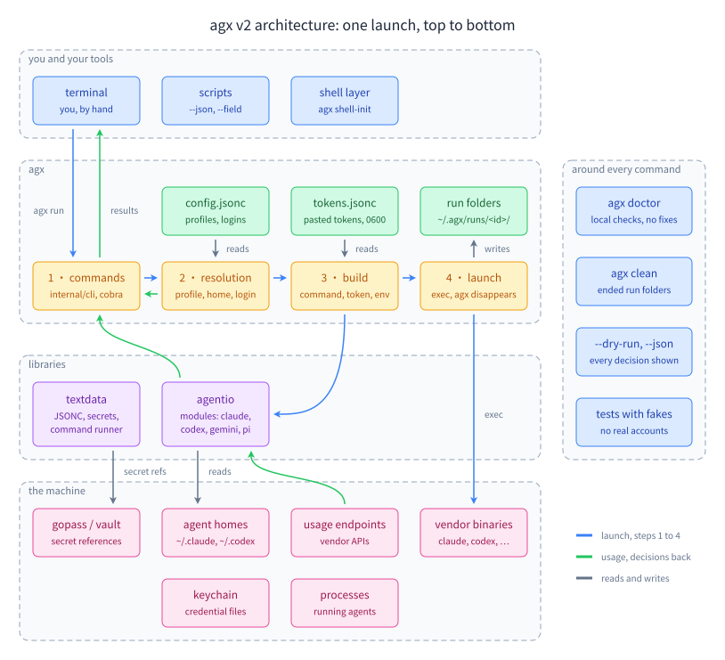

# agx documentation

agx is one CLI for coding agents (Claude Code, OpenAI Codex, Gemini CLI, pi, and agents you describe in config) across every account on the machine. Start with the learning path, or jump to your goal. Every output shown in these docs comes from a tested example in [examples](../examples/README.md).

## Learning path

From the first launch to the full setup. Each step names what you learn, the page that teaches it and the example that shows it.

| # | You learn | Guide | Example |
|---|---|---|---|
| 1 | install agx and the words it uses (agent, home, profile, login) | [Getting started](getting-started.md#before-you-start) | |
| 2 | write a starter config with `agx config init` | [Getting started: step 2](getting-started.md#step-2--write-a-starter-config) | [getting-started](../examples/getting-started/README.md) |
| 3 | turn the homes you already have into profiles with `agx profile import --discovered` | [Getting started: step 3](getting-started.md#step-3--import-the-homes-you-have) | [getting-started](../examples/getting-started/README.md), [quickstart](../examples/quickstart/README.md) |
| 4 | read plan usage for every home with `agx usage` | [Plan usage](guides/usage.md) | [acct-usage-cached](../examples/acct-usage-cached/README.md) |
| 5 | see every decision of a launch, and where it came from, with `agx run --dry-run` | [How agx decides](how-agx-decides.md#see-every-decision---dry-run) | [decide-launch-sources](../examples/decide-launch-sources/README.md) |
| 6 | launch with `agx run`, and what the agent receives (run folder, `AGX_RUN_*`, home variable) | [Run folders, whoami and clean](guides/run-folders.md) | [launch-run-folder](../examples/launch-run-folder/README.md) |
| 7 | add a second account as its own profile and home | [A second account](guides/second-account.md) | [acct-second-account](../examples/acct-second-account/README.md) |
| 8 | keep plan tokens and keys as logins, with the secret in gopass, and use them per run | [Logins](logins.md#adding-a-login) | [acct-login-kinds](../examples/acct-login-kinds/README.md), [acct-use-login](../examples/acct-use-login/README.md) |
| 9 | bind a folder to a profile or login, per agent, so a plain `agx run` there is right | [Folder bindings](guides/folder-bindings.md) | [decide-folder-binding](../examples/decide-folder-binding/README.md) |
| 10 | pass settings, options and environment: `--setting`, `--option`, `--env`, profile blocks | [Passing anything to an agent](launch-options.md) | [launch-settings](../examples/launch-settings/README.md), [launch-env](../examples/launch-env/README.md) |
| 11 | load the shell layer: `cd` after `new` and `resume`, `AGX_LOGIN` per terminal, aliases | [Shell layer](shell.md) | [shell-init](../examples/shell-init/README.md) |
| 12 | resume a conversation on another account, or switch a running session's login live | [Conversations](guides/conversations.md), [Live login](guides/live-login.md) | [convo-resume](../examples/convo-resume/README.md), [acct-live-login](../examples/acct-live-login/README.md) |
| 13 | script agx: `--json`, `--field`, exit codes, headless runs | [Scripting with agx](guides/scripting.md), [Headless runs](guides/headless.md) | [out-scripting](../examples/out-scripting/README.md), [launch-headless](../examples/launch-headless/README.md) |
| 14 | run several agents: Codex, Gemini CLI, pi, and one you describe in config | [Agents and what they support](guides/agents.md), [A custom agent](guides/custom-agent.md) | [agent-capabilities](../examples/agent-capabilities/README.md), [launch-gemini-pi](../examples/launch-gemini-pi/README.md), [cfg-custom-agent](../examples/cfg-custom-agent/README.md) |

## Start from your goal

| Goal | Guide | Example | Choosing |
|---|---|---|---|
| see quota on every account | [Plan usage](guides/usage.md) | [acct-usage-cached](../examples/acct-usage-cached/README.md) | [live, cached or probed](choosing/usage-live-or-cached.md) |
| start on the account with the most headroom | [Let agx pick by headroom](guides/auto-pick.md) | [acct-auto-pick](../examples/acct-auto-pick/README.md) | [where to set it](choosing/where-to-set.md) |
| add a second account | [A second account](guides/second-account.md) | [acct-second-account](../examples/acct-second-account/README.md) | [a second account](choosing/second-account.md) |
| use a token from gopass | [Logins: adding a login](logins.md#adding-a-login) | [acct-login-kinds](../examples/acct-login-kinds/README.md) | [which login kind](choosing/login-kind.md) |
| print a login's token for a script, a pipe or an `apiKeyHelper` | [Logins: print a login's token](logins.md#print-a-logins-token) | [acct-login-token](../examples/acct-login-token/README.md) | [which login kind](choosing/login-kind.md) |
| continue a chat on another account's quota | [Conversations: step 5](guides/conversations.md#step-5-resume-on-another-accounts-quota) | [convo-resume](../examples/convo-resume/README.md) | [continue on another account](choosing/continue-on-another-account.md) |
| switch a running session's account | [Live login](guides/live-login.md) | [acct-live-login](../examples/acct-live-login/README.md) | [continue on another account](choosing/continue-on-another-account.md) |
| let a session move between your and your teammates' Claude accounts by itself | [Share a pool of Claude accounts](guides/login-pool.md) | [acct-login-pool](../examples/acct-login-pool/README.md) | [continue on another account](choosing/continue-on-another-account.md) |
| pass a Claude setting or an environment variable for one run | [Passing anything: recipe 3](launch-options.md#recipe-3-one-settings-key-for-one-run), [recipe 5](launch-options.md#recipe-5-any-environment-variable) | [launch-settings](../examples/launch-settings/README.md), [launch-env](../examples/launch-env/README.md) | [which way to pass something](choosing/passing-options.md) |
| bind a folder to an account, per agent | [Folder bindings](guides/folder-bindings.md) | [decide-folder-binding](../examples/decide-folder-binding/README.md) | [where to set it](choosing/where-to-set.md) |
| run several profiles on one home (an API provider next to a plan) | [Shared homes](guides/shared-homes.md) | [decide-shared-home](../examples/decide-shared-home/README.md) | [a second account](choosing/second-account.md) |
| add Gemini CLI or pi | [Agents and what they support](guides/agents.md) | [launch-gemini-pi](../examples/launch-gemini-pi/README.md) | [which login kind](choosing/login-kind.md) |
| add an agent agx does not ship with | [A custom agent](guides/custom-agent.md) | [cfg-custom-agent](../examples/cfg-custom-agent/README.md) | [built-in or config-defined](choosing/custom-agent.md) |
| script agx in CI | [Scripting with agx](guides/scripting.md), [Headless runs](guides/headless.md) | [out-scripting](../examples/out-scripting/README.md), [launch-headless](../examples/launch-headless/README.md) | [with or without the shell layer](choosing/shell-layer.md) |
| clean up run folders and empty session folders | [Run folders: clean](guides/run-folders.md#step-5-clean-up-ended-runs), [Session folders](guides/session-folders.md#step-4-remove-the-folders-you-never-used) | [launch-run-folder](../examples/launch-run-folder/README.md), [session-clean](../examples/session-clean/README.md) | |
| find out why agx stopped | [Troubleshooting](troubleshooting.md), [Check your setup](guides/doctor.md) | [cfg-doctor](../examples/cfg-doctor/README.md), [out-exit-codes](../examples/out-exit-codes/README.md) | |

## Guides

| Guide | Read it when |
|---|---|
| [Getting started](getting-started.md) | you are new: install, a first config, the first launches |
| [How agx decides](how-agx-decides.md) | you want to know which profile, home and login a launch uses, and why |
| [Passing anything to an agent](launch-options.md) | you need settings, typed options, environment, credentials or raw flags on a launch |
| [Logins](logins.md) | you run several accounts: plan tokens, API keys, `AGX_LOGIN`, live switching |
| [A second account](guides/second-account.md) | you add another account as its own profile and home |
| [Let agx pick by headroom](guides/auto-pick.md) | you want `--auto-profile` or `--auto-login` to choose the account |
| [Plan usage](guides/usage.md) | you read quota: live, cached, per stored login |
| [Live login](guides/live-login.md) | you switch a running Claude session to another login |
| [Share a pool of Claude accounts](guides/login-pool.md) | a `pool` login picks the Claude account for each key by usage, while the session runs |
| [Folder bindings](guides/folder-bindings.md) | you bind a folder to a profile or login, per agent |
| [Shared homes](guides/shared-homes.md) | several profiles use one home, and resume or usage must pick one |
| [Run folders, whoami and clean](guides/run-folders.md) | you want to know what a launch leaves behind and what the agent receives |
| [Autonomy](guides/autonomy.md) | you set how much an agent may do without asking, per agent |
| [Raw args](guides/raw-args.md) | you pass flags agx does not model: agent defaults, profile `args`, after `--` |
| [Headless runs and a first prompt](guides/headless.md) | you run one task non-interactively, in scripts or CI |
| [Conversations](guides/conversations.md) | you find, resume and move conversations across accounts |
| [Session folders](guides/session-folders.md) | you use `agx new` scratch folders: list, clean, promote |
| [Shell layer](shell.md) | you want your shell to follow `agx new` and `agx resume`, per-terminal logins and aliases |
| [Agents and what they support](guides/agents.md) | you want to know what each agent can do with agx, and why not |
| [A custom agent](guides/custom-agent.md) | you describe an agent CLI agx does not ship with |
| [Check your setup](guides/doctor.md) | you run `agx doctor` and the config tools |
| [Scripting with agx](guides/scripting.md) | you script agx: JSON, `--field`, exit codes |
| [Output and exit codes](output.md) | you need the exact JSON envelope, cost classes and every exit code |
| [Config reference](config.md) | you edit `config.jsonc` by hand |
| [Troubleshooting](troubleshooting.md) | agx stopped with a message |
| [Coming from v0.3](coming-from-v0.3.md) | you used `github.com/khanakia/agx` |

## Choosing

[Decision guides](choosing/README.md) for the places where agx offers more than one way:

- [Which login kind](choosing/login-kind.md)
- [A second account](choosing/second-account.md)
- [Where to set the profile and login](choosing/where-to-set.md)
- [Which way to pass something to an agent](choosing/passing-options.md)
- [Settings as a file or inline](choosing/settings-delivery.md)
- [Usage: live, cached or probed](choosing/usage-live-or-cached.md)
- [Continue on another account](choosing/continue-on-another-account.md)
- [Built-in or config-defined agent](choosing/custom-agent.md)
- [With or without the shell layer](choosing/shell-layer.md)

## Command reference

[Every command and flag](commands/README.md), grouped:

- [Launching](commands/launch.md): `run`, `new`, `resume`, `whoami`
- [Usage](commands/usage.md): `usage`
- [Conversations and sessions](commands/conversation.md): `conversation`, `session`
- [Live login](commands/live.md): `live`
- [Profiles](commands/profile.md): `profile`
- [Logins](commands/login.md): `login`
- [Pools](commands/pool.md): `pool`
- [Projects](commands/project.md): `project`
- [Setup and tools](commands/setup.md): `agent`, `doctor`, `clean`, `config`, `alias`, `shell-init`, `completion`, `help`, `version`

## Feature index

[Every feature](reference/features.md) of agx (commands, flags, config keys, environment variables, exit codes) in one table, with the guide section and the example that show it.

## Examples

[Every example](../examples/README.md), grouped by topic. Each is a scripted session that runs in the test suite on a fake machine.

## Architecture

agx keeps no vendor knowledge of its own: everything an agent can or cannot do comes from agentio, and config files, secrets and commands go through textdata.

## How these docs are checked

The examples and the blocks marked as runnable are run against a test machine with fake agents on every `go test ./internal/docscheck/`, and their output must match; a block marked as a snippet must equal its region of an example file. The same gate fails when a command or flag of agx is missing from the command reference, when a config key is missing from the config reference, when a link is broken, or when a paragraph is hard-wrapped. The conventions are in the package comment of `internal/docscheck`.
